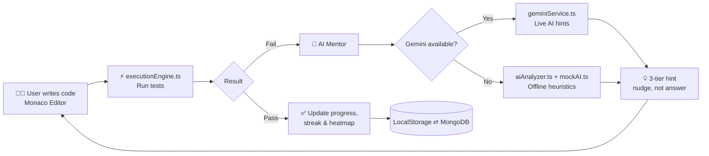

<div align="center">


<a href="https://github.com/Kanishka-K07/CodeMentor_AI">
  
</a>

<br/>


**[Features](#-features) • [How It Works](#-how-it-works) • [Tech Stack](#-tech-stack) • [Architecture](#-architecture) • [Getting Started](#-getting-started) • [Roadmap](#-roadmap)**

</div>

---

## 🎯 About

**CodeMentor AI** is a full-stack, AI-powered coding and DSA learning platform. Traditional online judges only tell you *"Accepted"* or *"Wrong Answer"*. CodeMentor AI acts as a **Socratic mentor and pair programmer**: it nudges you toward the solution instead of handing it over.

> 💡 **Guided discovery over direct answers.** Progressive 3-tier hints, conceptual nudges, and time/space complexity critiques help you actually *learn* the algorithm.

---

## ✨ Features

| | Feature | Description |
|---|---|---|
| 💻 | **Interactive Workspace** | Monaco editor (Java and Python), theme toggle, run/submit controls, live output console |
| 🧠 | **Socratic AI Mentor** | Chat and review panel that analyzes compile errors and logic bugs and gives targeted progressive hints |
| ⚡ | **In-Browser Judge** | Runs visible example tests and hidden edge cases with pass/fail breakdown, runtime and memory stats |
| 📚 | **50+ Curated Problems** | Easy / Medium / Hard across Arrays, Strings, DP, Graphs, Trees, Heaps, Backtracking |
| 🛠️ | **AI Problem Generator** | Generate new problems on demand for any topic and difficulty |
| 📊 | **Dashboard & Heatmap** | GitHub-style contribution heatmap, topic mastery charts, solve counters, streaks |
| 💾 | **Draft Persistence** | Auto-saves code per problem and per language across sessions |
| 🔐 | **Auth & Profiles** | JWT authentication, bcrypt hashing, avatar customization, profile stats |
| 🔌 | **Offline Fallback** | Heuristic analyzers keep the mentor working with no API key or internet |

---

## 🧩 How It Works



### 💡 The 3-Tier Hint System

<details>
<summary><b>Click to see how hints escalate</b></summary>

1. **Tier 1: Conceptual nudge.** Which pattern or data structure might fit?
2. **Tier 2: Approach outline.** The shape of the algorithm, without code.
3. **Tier 3: Pseudocode-level guidance.** Close to the solution, but you still write it.

</details>

---

## 🛠️ Tech Stack

<table>
<tr>
<td valign="top" width="33%">

**🎨 Frontend**
- React 19 + TypeScript
- Vite
- Tailwind CSS v4
- Framer Motion
- Recharts
- react-router-dom v7
- react-hot-toast
- Lucide React

</td>
<td valign="top" width="33%">

**⚙️ Backend**
- Node.js + Express 5 (ESM)
- MongoDB + Mongoose
- JWT (`jsonwebtoken`)
- `bcryptjs`
- CORS
- `concurrently`

</td>
<td valign="top" width="33%">

**🤖 AI & Execution**
- Google Gemini API
- Structured prompt templates
- Rule-based fallback analyzer
- In-browser test runner
- Monaco Editor

</td>
</tr>
</table>

---

## 🏗️ Architecture

<details>
<summary><b>📁 Project structure (click to expand)</b></summary>

```
CodeMentor_AI/
├── server/                          # Express + MongoDB backend
│   ├── models/                      # User, Submission, Progress, CodeDraft, UserStats
│   ├── routes/auth.js               # Login, Register, Profile (JWT)
│   └── index.js                     # Submissions, progress, drafts, stats, bulk sync
│
└── src/                             # React + TypeScript frontend
    ├── components/                  # ContributionHeatmap, Navbar, Badges, ...
    ├── data/
    │   ├── problems.ts              # 50 curated problems, tests, starter templates
    │   └── mockAI.ts                # Offline hints and fallback responses
    ├── pages/
    │   ├── ProblemWorkspace.tsx     # Editor + Judge + Test Cases
    │   ├── AICodeMentor.tsx         # Step-by-step AI guidance
    │   ├── Dashboard.tsx            # Charts, activity, topic mastery
    │   ├── ProblemList.tsx          # Filter by difficulty / topic / status
    │   ├── Profile.tsx              # User info, avatar, stats
    │   └── Login.tsx / Register.tsx
    ├── services/
    │   ├── executionEngine.ts       # Client-side test evaluator
    │   ├── geminiService.ts         # Gemini client for reviews & hints
    │   ├── aiAnalyzer.ts            # Logic error and complexity analyzer
    │   ├── customProblemService.ts  # AI problem generator
    │   └── storageService.ts        # LocalStorage + MongoDB sync
    ├── store/
    │   ├── AppContext.tsx           # Submissions, drafts, problem stats
    │   └── AuthContext.tsx          # Auth session
    └── types/index.ts               # Strict TypeScript types
```

</details>

---

## 🚀 Getting Started

### Prerequisites

- [Node.js](https://nodejs.org/) v18 or higher
- [MongoDB](https://www.mongodb.com/) (local instance or Atlas URI)
- *(Optional)* a [Google Gemini API key](https://aistudio.google.com/). Without one, the offline mentor is used.

### Installation

```bash
# 1. Clone the repository
git clone https://github.com/Kanishka-K07/CodeMentor_AI.git
cd CodeMentor_AI

# 2. Install dependencies
npm install

# 3. Configure environment variables (see below)
cp .env.example .env

# 4. Start frontend + backend together
npm run dev
```

### 🔑 Environment Variables

Create a `.env` file in the project root. Adjust the names to match your code.

```env
# Backend
MONGODB_URI=mongodb://localhost:27017/codementor
JWT_SECRET=your_super_secret_key
PORT=5000

# AI (optional: falls back to offline mentor if empty)
GEMINI_API_KEY=your_gemini_api_key
```

> ⚠️ **Never commit your `.env` file.** Make sure it is listed in `.gitignore`.

---

## 🗺️ Roadmap

- [x] Monaco workspace with Java and Python
- [x] Socratic 3-tier AI hints
- [x] Offline fallback mentor
- [x] Dashboard, heatmap and streaks
- [x] AI custom problem generator
- [ ] More languages (C++, JavaScript)
- [ ] Server-side sandboxed code execution
- [ ] Leaderboards and friends
- [ ] Contest mode

---

## 🤝 Contributing

Contributions are welcome!

1. Fork the repo
2. Create your branch: `git checkout -b feature/amazing-feature`
3. Commit your changes: `git commit -m "Add amazing feature"`
4. Push: `git push origin feature/amazing-feature`
5. Open a Pull Request

---

## 📸 Screenshots

> Add your screenshots to a `/docs` folder and uncomment the lines below.

<!--
| Workspace | AI Mentor | Dashboard |
|---|---|---|
|  |  |  |
-->

---

## 📄 License

Distributed under the MIT License. See `LICENSE` for details.

---

<div align="center">

**Built with ❤️ by [Kanishka](https://github.com/Kanishka-K07)**

⭐ If you found this useful, please star the repo!


</div>
